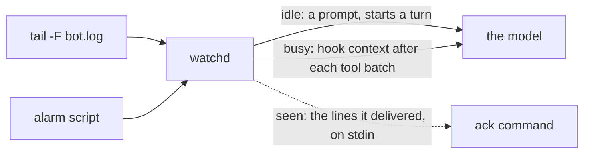

# watchd

A Claude Code mod that keeps event watchers running for the whole life of a
session. Each watch is a command; every line it prints on stdout reaches the
model as an event: it wakes the session when idle, and gets in between tool
calls when a turn is running.



It replaces the built-in `Monitor` tool for long-running watches. `Monitor`
caps every watch at 30 minutes, so a session that tails logs all day re-arms
each watch twice an hour, spending a turn each time for nothing. watchd has no
cap: a watch runs until the session ends, it exits, or you remove it.

## Install

At the prompt of a Claude Code session:

```
/plugin install watchd --marketplace vjt/claude-watchd
```

Answer `y` to add the marketplace, pick a scope (user: every session from now
on), and it is active right away. From a shell, the same:

```bash
claude plugin install watchd --marketplace vjt/claude-watchd
```

Then ask the session to watch something (below): it starts listening within
five seconds. The mod does nothing in a project without a
`.claude/watchd.json`, so it is safe to install everywhere.

**From a checkout**, to hack on it: `claude --plugin-dir /path/to/claude-watchd`
for one session, or for every session the `env` block of
`~/.claude/settings.json`; edits reload at the end of each session's turn.

```json
{ "env": { "CLAUDE_CODE_PLUGIN_DIRS": "/path/to/claude-watchd" } }
```

## Configure

Ask for it. The plugin ships a skill, `watchd:watch`, so in any session:

> watch the nginx error log and tell me about 5xx
>
> stop watching nginx
>
> what are you watching?

Claude writes the entry, tries the command by hand, checks that it started,
and keeps it quiet, flushed and replay-free (the rules below). The file it
edits is `.claude/watchd.json`, under the session's working directory, and you
can of course write it yourself:

```json
{
  "watches": [
    { "name": "bot",    "argv": ["bash", "tools/tail-bot-events.sh"] },
    { "name": "alarms", "command": "tail -n0 -F ~/alarms.log | grep --line-buffered -v '^$'" }
  ]
}
```

- `argv` runs as is; `command` runs under `bash -c`.
- Relative paths resolve against the session's working directory.
- The file is re-read every 5 seconds: add an entry and it starts, remove it and
  it stops, change it and it restarts. No restart of the session needed, so a
  temporary watch is one edit away.

Filter in the command, not in the model: every line printed is a turn. Flush
per line (`grep --line-buffered`, `awk` with `fflush()`, `stdbuf -oL`), or
events sit in a pipe buffer.

## What the model sees

On an idle session, lines are batched (200 ms) and submitted as a plugin
prompt, one turn per batch, prefixed with the watch name:

```
[bot] MSG FROM=alice BODY=hello
[alarms] disk 91% on /srv
```

Claude Code starts a plugin prompt only once the session is idle, so lines that
arrive while a turn runs are held and handed to the model after each batch of
tool calls, as hook context (PostToolBatch), without interrupting the turn.
Whatever is still held when the turn ends is submitted then. A single long tool
call (a blocking hook, a long foreground command) holds them until it returns.

A watch may name a `seen` command (`argv` list, or a string for `bash -c`): it
runs whenever that watch's lines are handed to the model, with those lines,
unprefixed, on its stdin. Use it to tell the source they were read (claude-tgbot
puts a 👀 on the Telegram messages):

```json
{ "name": "tg", "command": "tail -F -n0 bot.stdout.log",
  "seen": ["python3", "/path/to/claude-tgbot/hooks/turn.py", "--seen", "/path/to/consumer"] }
```

## Listing the watches

`/watchd` lists each watch: state and for how long, lines delivered, when the
last one came and what it said, restarts, whether it has a `seen` command, and
the command itself; on top, whether a turn runs and how many lines are held.

```
watchd /home/me/project · turn idle · held 0

🟢 bot up 2h · 41 lines · last 3m ago · 0 restarts · 👀 seen
tail -F -n0 bot.stdout.log | grep --line-buffered '^MSG '
↳ MSG 1234 5678 "hello" user=alice

🟡 alarms restarting 12s · 0 lines · last – · 1 restarts
bash tools/alarms.sh
```

## Failures

- A watch that exits is reported (`[watchd] bot exited (code 1); restarting in 30s`)
  and restarted after 30 seconds.
- Five exits in a row, each within 10 minutes of starting, and it is given up,
  which is reported too.
- An unreadable or invalid `watchd.json` is reported, and the running watches
  are left as they were.
- The status line reads `watchd 3/3`, or `watchd 2/3 down: alarms`.
- stderr of a watch goes to the debug log (`claude --debug`), not to the model.

## Telling watchd is on

Every child, and everything it forks, carries `WATCHD=<name>` and
`WATCHD_DIR=<session working directory>` in its environment. A startup script
that would otherwise attach `Monitor`s checks for its own project, since other
sessions' watches carry their own directory:

```bash
grep -lsxzF "WATCHD_DIR=$PWD" /proc/[0-9]*/environ | wc -l
```

## Known gaps

- **Nothing gets in during a single tool call.** A blocking hook or a long
  foreground command holds the lines until it returns; the model could not
  read them before that anyway.
- **watchd tracks the turn itself.** Claude Code has no call that says whether
  a turn is running, a plugin prompt starts only once the session is idle, a
  queued one cannot be taken back, and a session cannot message itself. So
  watchd follows `turn.start` / `turn.complete`. When the mod reloads (it does
  only when its files change, at the end of each session's turn), a line that
  arrives before the new turn's first tool batch can still be queued behind
  that turn.
- `/clear` does not run `session.start` again; the watches outlive it.

## License

MIT
